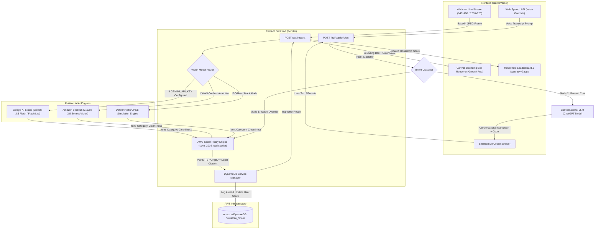

# Sankalp-Squad: ShieldBin
### Autonomous Source-Level Waste & Contamination Intelligence Inspector
**Bharat Builds Tour: Environmental Hacks (Track 03 — Waste and Energy)**  
*Powered by Amazon Bedrock (Claude 3.5 Sonnet), AWS Cedar Policy Engine, Amazon DynamoDB, Google AI Studio Multimodal Vision (Gemini 2.5 Flash), deployed on Render (Backend) & Vercel (Frontend).*

---

## 🌍 Major Problems ShieldBin Solves

Municipal solid waste management in India and worldwide faces a severe operational failure at the household and commercial generation point. **ShieldBin** directly tackles the root causes of this crisis:

### 1. The 70%+ Recyclables Contamination Crisis
- **The Issue:** Recyclable materials (paper, plastics, cardboard) lose all economic and recycling value the moment they are contaminated with food grease, residual cooking oils, or unrinsed milk/yogurt residues. A single unwashed pizza box or oily food pouch placed inside a dry recycling bin can ruin an entire municipal truckload (over 70% of recyclable material collected in urban centers is diverted straight into overflowing landfills).
- **ShieldBin Solution:** Uses deep multimodal vision to assess **material cleanliness and grease saturation** *before* the item is dropped into the bin, catching contamination at the absolute source.

### 2. Catastrophic Landfill & Compactor Fires from E-Waste
- **The Issue:** Citizens frequently throw discarded electronics, power banks, charging cables, and lithium-ion batteries into domestic bins. Under mechanical compactor pressure inside waste trucks or landfills, damaged lithium cells experience thermal runaway, causing massive, uncontrollable municipal fires and leaching toxic heavy metals (lead, cadmium, mercury) into groundwater.
- **ShieldBin Solution:** Implements a strict statutory ban on electronic waste in domestic waste streams. When an electronic or battery item is detected, ShieldBin immediately triggers a high-priority red alert and routes the citizen to an authorized CPCB collection kiosk.

### 3. The "Zero CapEx" Hardware Dilemma for Municipalities
- **The Issue:** Traditional "smart bin" solutions require expensive optical sensors, robotic sorters, load cells, and custom IoT hardware costing hundreds of dollars per bin—making city-wide adoption across millions of households economically impossible.
- **ShieldBin Solution:** Requires **Zero Custom Hardware**. Runs entirely in the browser on any citizen's existing smartphone or laptop webcam via modern WebRTC and HTML5 Canvas.

### 4. Bridging the Statutory Policy Gap (MoEFCC SWM 2016 & CPCB E-Waste 2022)
- **The Issue:** Environmental laws exist on paper (e.g. MoEFCC Solid Waste Management Rules 2016, Rule 15; CPCB E-Waste Rules 2022, Schedule I), but citizens are confused about which bin items belong to (e.g., *Is a grease-stained pizza box recyclable? Can milk pouches go into dry waste without rinsing?*).
- **ShieldBin Solution:** Encodes statutory environmental mandates directly into deterministic policy-as-code using the **AWS Cedar Policy Engine**. Every disposal action receives a formal statutory verdict (`PERMIT` or `FORBID`) backed by legal citations.

### 5. Citizen Disengagement & Lack of Accountability
- **The Issue:** Citizens receive no immediate feedback or incentives for segregating waste properly at home.
- **ShieldBin Solution:** Integrates real-time gamification via **Amazon DynamoDB**, tracking individual household segregation accuracy, contamination violation risks averted, and ward-level leaderboards.

### 6. Edge Case Confusion & Citizen Inquiries
- **The Issue:** Citizens encounter ambiguous items and need instant guidance without digging through municipal PDF manuals.
- **ShieldBin Solution:** Embeds the **ShieldBin AI Copilot**, a dual-purpose conversational assistant that accepts natural voice/text overrides (e.g. *"This box has grease at the bottom"*) to re-audit live frames against CPCB rules, while also functioning as an open conversational assistant (like ChatGPT) for recycling science, coding queries, and everyday questions.

---

## ☁️ AWS Cloud Services Utilized (Excluding AWS Deployment)

While our production deployment utilizes **Render** (Backend) and **Vercel** (Frontend) for agile cloud hosting, the core intelligence and data infrastructure relies on AWS cloud technologies:

| AWS Service | Architectural Role | Details |
|---|---|---|
| **Amazon Bedrock** | Multimodal Vision Foundation Model | Runs Anthropic Claude 3.5 Sonnet (`anthropic.claude-3-5-sonnet-20240620-v1:0`) and Claude 3 Haiku for deep visual material detection, grease inspection, and object verification. |
| **AWS Cedar Policy Engine** | Statutory Policy-as-Code Guardrails | Deterministic open-source policy engine evaluating disposal requests against Indian environmental mandates (`policies/swm_2016_cpcb.cedar`). Returns legally binding `PERMIT` or `FORBID` verdicts. |
| **Amazon DynamoDB** | NoSQL Telemetry & Gamification Database | Low-latency table (`ShieldBin_Scans`) storing real-time audit logs, scan coordinates, household accuracy percentages, and contamination-prevented counters. |

---

## 🚀 Cloud Deployment Architecture

- **Frontend Application:** Deployed on **[Vercel](https://vercel.com)**
  - Built with Vite, React 18, TypeScript, and Tailwind CSS.
  - Features deep OLED dark styling (`#0B0F17`), translucent glassmorphism, native Web Speech API voice recognition, and real-time canvas overlays.
- **Backend API Service:** Deployed on **[Render](https://render.com)**
  - Built with FastAPI, Uvicorn, and Python 3.12.
  - Automated deployment configured via [`render.yaml`](./render.yaml).

---

## 🧠 Multimodal Vision & API Key Configuration

ShieldBin features a multi-tiered vision and intelligence pipeline:

1. **Primary Vision Engine:** **Google AI Studio (Gemini Vision)**
   - Configured via `GEMINI_API_KEY` in backend environment variables.
   - Automatically utilizes fast multimodal vision models (`gemini-3.6-flash`, `gemini-3.5-flash-lite`, `gemini-3.1-flash-lite`, `gemini-flash-lite-latest`) for rapid frame processing.
2. **Enterprise Vision Engine:** **Amazon Bedrock (Claude 3.5 Sonnet Vision)**
   - Configured via `AWS_ACCESS_KEY_ID`, `AWS_SECRET_ACCESS_KEY`, and `AWS_REGION` (`us-east-1`).
   - Serves as the high-accuracy foundation model for material and packaging analysis.
3. **Deterministic Simulation Engine (Zero-Credentials Mode):**
   - Configured via `USE_MOCK_BEDROCK=true`.
   - Allows zero-dependency local development, automated testing, and CI/CD pipelines with high-fidelity mock data.

---

## 🏗️ System Architecture & Workflow



---

## 🤖 ShieldBin AI Copilot (Dual-Purpose Assistant)

The ShieldBin AI Copilot (`POST /api/copilot/chat`) operates with dual-mode intelligence:

### Mode 1: Waste-Inspection & CPCB Override Mode
When a user provides a short item name, waste correction, or voice command (e.g. *"banana peel"*, *"lithium battery"*, *"That's a mobile, not paper"*, *"greasy pizza box"*):
- Evaluates against **Central Pollution Control Board (CPCB)** source segregation rules.
- Emits a standardized 5-point structured card:
  ```text
  - Item Name: [Detected item]
  - Category: [Sanitary / Landfill | Dry Recyclable | Wet Organic | E-Hazardous]
  - Assigned Bin: [Black Bin | Blue Bin | Green Bin | Specialized E-Waste Drop-off Center]
  - Risk Points: [-X Points]
  - Explanation: [Short reason why contamination occurs]
  ```
- Automatically triggers the **AWS Cedar policy engine**, logs scores in **Amazon DynamoDB**, and updates the live camera overlay canvas.

### Mode 2: General Chat Mode (Like ChatGPT)
When a user asks open-ended questions, science topics, coding queries, or casual conversation (e.g. *"How does recycling work?"*, *"Write a Python script for binary search"*, *"Tell me a joke"*, *"What is photosynthesis?"*):
- Completely bypasses the waste audit card format.
- Answers conversationally with styled markdown, bullet points, and syntax-highlighted code blocks (`<pre><code>`).
- Leaves the live camera viewfinder and DynamoDB scores untouched.

---

## 📋 Statutory Indian Waste Segregation Standards (CPCB / SWM 2016)

| Bin Color | Stream Category | Permissible Items | Strict Statutory Rules |
|---|---|---|---|
| 🔵 **Blue Bin** | **Dry Recyclable** | Clean paper, cardboard, PET bottles, metal cans, glass jars. | Must be **clean and dry**. Food grease contamination degrades paper pulping slurries. |
| 🟢 **Green Bin** | **Wet Organic** | Vegetable & fruit peels, food leftovers, eggshells, tea leaves. | Compostable biomass. Never dispose in sealed non-biodegradable plastic bags. |
| 🟡 **Yellow Center** | **E-Hazardous / E-Waste** | Phones, lithium batteries, chargers, cables, circuit boards. | **Zero Landfill Ban (CPCB 2022).** Deposit only at authorized e-waste take-back kiosks. |
| ⚫ **Black Bin** | **Sanitary / Landfill** | Greasy pizza boxes, diapers, sanitary pads, inert reject trash. | Non-recoverable reject waste sent to scientific sanitary landfills. |

---

## 📁 Repository Structure

```text
Sankalp-Squad/
├── backend/
│   ├── app/
│   │   ├── main.py               # REST API endpoints (inspect, copilot/chat, user/score)
│   │   ├── bedrock_service.py    # Multi-engine vision client (Gemini + Bedrock Claude)
│   │   ├── cedar_service.py      # AWS Cedar statutory policy evaluator
│   │   ├── dynamodb_service.py   # DynamoDB audit logging & leaderboard manager
│   │   ├── models.py             # Pydantic schemas (InspectRequest, CopilotChat, etc.)
│   │   ├── prompts.py            # CPCB SWM 2016 vision system prompts
│   │   └── config.py             # Application settings & environment loader
│   ├── policies/
│   │   └── swm_2016_cpcb.cedar   # AWS Cedar statutory policies (SWM 2016 & E-Waste 2022)
│   ├── requirements.txt          # Python dependencies (FastAPI, Uvicorn, Boto3, Pillow)
│   ├── test_api.py               # Automated test suite
│   └── README.md
├── frontend/
│   ├── src/
│   │   ├── components/
│   │   │   ├── CameraInspector.tsx # Viewfinder, live video stream, canvas overlay
│   │   │   ├── InspectionResult.tsx# Waste inspection card, confidence gauge, Cedar badge
│   │   │   ├── AiChatBox.tsx      # Dual-mode AI Copilot drawer with Web Speech API
│   │   │   └── ScoreBoard.tsx     # Real-time DynamoDB accuracy rate & leaderboard
│   │   ├── App.tsx               # Main application layout & theme provider
│   │   ├── types.ts              # TypeScript interfaces
│   │   └── index.css             # OLED dark glassmorphism styling tokens
│   ├── package.json
│   ├── vite.config.ts
│   └── index.html
├── render.yaml                   # Render deployment configuration for Backend
├── .gitignore
└── README.md
```

---

## 🛠️ Environment Variables Configuration

Create a `.env` file in the `backend/` directory based on [`backend/.env.example`](./backend/.env.example):

```bash
# AWS Credentials (Amazon Bedrock & Amazon DynamoDB)
AWS_REGION=us-east-1
AWS_ACCESS_KEY_ID=your_aws_access_key_id
AWS_SECRET_ACCESS_KEY=your_aws_secret_access_key
AWS_SESSION_TOKEN=optional_session_token_if_temporary

# Google AI Studio Multimodal Vision (Primary Engine)
GEMINI_API_KEY=your_google_ai_studio_api_key
GEMINI_MODEL_ID=gemini-3.6-flash

# Amazon Bedrock Settings
BEDROCK_MODEL_ID=anthropic.claude-3-5-sonnet-20240620-v1:0
USE_MOCK_BEDROCK=false

# Amazon DynamoDB Settings
DYNAMODB_TABLE_NAME=ShieldBin_Scans
ENABLE_DYNAMODB_LOGGING=true

# Server Settings
HOST=0.0.0.0
PORT=8000
```

For the frontend in `frontend/.env`:

```bash
VITE_API_URL=http://localhost:8000
```

---

## 💻 Local Development Setup

### 1. Backend Service
```bash
cd backend
python -m venv .venv
# On Windows:
.venv\Scripts\activate
# On Linux/macOS:
source .venv/bin/activate

pip install -r requirements.txt
python -m uvicorn app.main:app --reload --port 8000
```
Interactive API documentation: `http://localhost:8000/docs`

### 2. Frontend Client
```bash
cd frontend
npm install
npm run dev
```
Open `http://localhost:5173` in your browser.

---

## 🏆 Hackathon Submission Metadata
- **Event:** Bharat Builds Tour (Environmental Hacks)
- **Track:** Track 03 — Waste and Energy
- **Team:** Sankalp Squad
- **Frontend URL:** Deployed on Vercel
- **Backend API URL:** Deployed on Render

---
## 👥 Team

| Name | Role |
|------|------|
| **Garv Ghildiyal** | 👑 Team Leader |
| **Devesh Singh Rawat** | Team Member |
| **Abhinav Singh** | Team Member |
| **Abhinav Chauhan** | Team Member |
