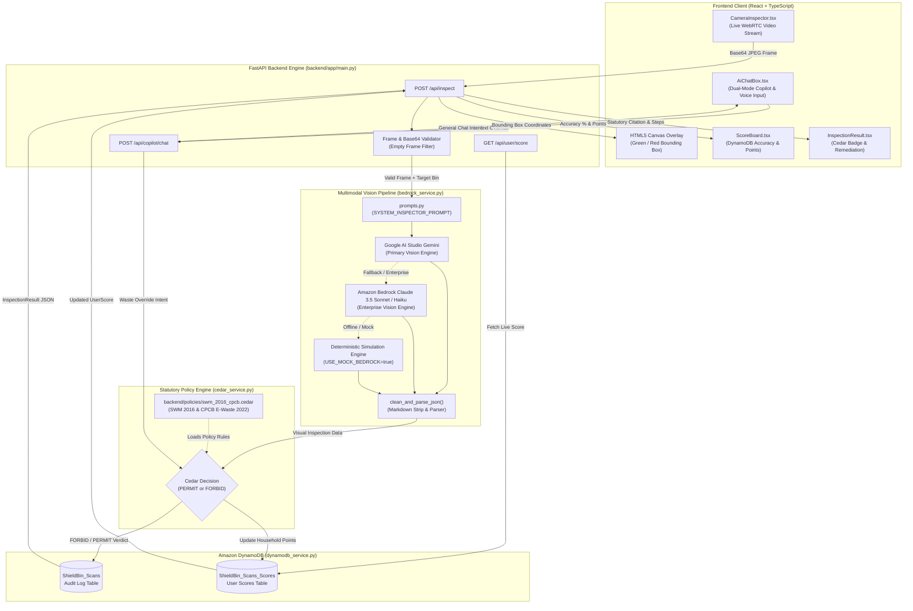

<div align="center">

# 🛡️ ShieldBin
### Autonomous Source-Level Waste & Contamination Intelligence Inspector

[](https://sankalp-squad.vercel.app/)
[](https://sankalp-squad.vercel.app/)
[](https://sankalp-squad.vercel.app/)
[](https://sankalp-squad.vercel.app/)
[](https://sankalp-squad.vercel.app/)
[](https://sankalp-squad.vercel.app/)
[](https://sankalp-squad.vercel.app/)
[](https://sankalp-squad.vercel.app/)

### 🚀 [Experience Live Demo: sankalp-squad.vercel.app](https://sankalp-squad.vercel.app/)

</div>

---

## 📌 2. What is ShieldBin?

**ShieldBin** is an autonomous, source-level waste and contamination inspection system that brings artificial intelligence directly to the point of disposal. Rather than attempting to sort mixed garbage after collection at expensive centralized recycling centers, ShieldBin prevents contamination **before the waste leaves the citizen's hand**.

Using any standard smartphone or laptop camera, ShieldBin captures live frames and executes sub-second multimodal visual inspection using Google Gemini Vision (backed by Amazon Bedrock Claude Vision for enterprise fallback) to detect materials, grease saturation, and hazardous components. It submits the classification to the **AWS Cedar Policy Engine**. Cedar evaluates the action against Indian statutory environmental laws, delivering an immediate, legally binding **PERMIT** or **FORBID** verdict with real-time green/red bounding box overlays. The citizen receives explicit bin guidance, corrective remediation steps, and instant gamification rewards tracked in **Amazon DynamoDB**.

With **Zero Custom Hardware** required, ShieldBin runs instantly in any modern web browser—eliminating municipal CapEx barriers while ensuring compliance with national segregation mandates.

---

## ⚠️ 3. The Main Problem We Solve

| Problem | Real-World Impact | ShieldBin's Answer |
|---|---|---|
| **70%+ Recyclables Contamination** | Placing greasy pizza boxes, oily cardboard, or unrinsed milk pouches into dry recycling bins introduces food grease that coats paper pulpers. A single contaminated item ruins entire truckloads of recyclables, causing over 70% of collected urban recyclables to be dumped directly into landfills. | Deep multimodal vision evaluates material cleanliness and grease saturation in real time. AWS Cedar enforces `policy_swm_grease_contamination_forbid`, issuing a statutory `FORBID` and instructing the citizen to tear away clean sections for recycling and divert soiled portions to landfill waste. |
| **Catastrophic E-Waste & Lithium Fires** | Discarded mobile phones, lithium-ion battery packs, cables, and electronics thrown into municipal bins undergo severe crushing inside compactor trucks and landfills. This triggers uncontrollable thermal runaway fires and leaches toxic heavy metals (lead, cadmium, mercury) into groundwater. | Enforces strict statutory bans under CPCB E-Waste Rules 2022 Schedule I via Cedar `policy_cpcb_ewaste_hazard_ban`. Flashes an immediate high-priority red alert and routes the citizen directly to authorized e-waste collection kiosks. |
| **Municipal Hardware CapEx Barrier** | Traditional "smart bins" require dedicated optical sensors, robotic arms, pneumatic sorters, and custom IoT microcontrollers costing hundreds of dollars per unit, making city-wide deployment across millions of urban households economically impossible. | **Zero Custom Hardware Required.** Runs client-side in any web browser on existing citizen smartphones or computers using HTML5 Canvas and WebRTC video capture. |
| **Statutory Policy-to-Practice Gap** | While statutory frameworks exist on paper (MoEFCC Solid Waste Management Rules 2016 Rule 15; CPCB E-Waste Rules 2022 Schedule I), citizens remain confused about subtle disposal rules, creating widespread non-compliance at the bin. | Encodes statutory environmental mandates directly into deterministic policy-as-code using the **AWS Cedar Policy Engine**. Every disposal action receives a legally validated verdict (`PERMIT` or `FORBID`) accompanied by official gazette citations. |
| **Citizen Disengagement & Lack of Feedback** | Citizens lack immediate feedback, transparency, or tangible incentives to properly segregate waste at home, leading to habitual cross-contamination. | Real-time gamification powered by **Amazon DynamoDB** tracks household points (+15 for clean segregation, -10 for violations), segregation accuracy rates, and ward-level environmental impact leaderboards. |
| **Edge-Case Confusion & Ambiguity** | Citizens encounter ambiguous items (e.g., composite packaging, half-clean boxes) and have no accessible way to resolve queries without reading through complex municipal manuals. | Embeds the **ShieldBin AI Copilot**, a dual-purpose conversational assistant that accepts natural voice or text overrides to re-audit live frames against CPCB rules while also answering broad circular sustainability and scientific queries. |

---

## ✨ 4. Key Features

- 📹 **Live Camera Viewfinder & Bounding Box Overlay**: Streams webcam video and renders dynamic green (compliant) or red (contaminated/wrong bin) bounding boxes directly onto an HTML5 canvas overlay.
- 🧠 **Multi-Tiered Vision Pipeline**: Combines Google AI Studio Gemini Vision as the high-speed primary engine with Amazon Bedrock Claude 3.5 Sonnet for enterprise deep visual audits, with deterministic mock fallback support.
- 🛡️ **AWS Cedar Statutory Policy Guardrails**: Enforces deterministic, legally validated rules of Indian environmental law (MoEFCC SWM 2016 & CPCB E-Waste 2022) as code.
- 🎮 **DynamoDB Audit Trail & Household Gamification**: Persists every scan event, coordinate set, and compliance decision to `ShieldBin_Scans`, dynamically maintaining household accuracy percentages and ward scores.
- 🎙️ **Voice-Enabled AI Copilot**: Features dual-mode intelligence with Web Speech API integration for instant voice overrides and conversational sustainability inquiries.
- ⚡ **Zero-CapEx Deployment**: Operates purely in standard web browsers without requiring IoT installations, microcontrollers, or smart bin modifications.
- 🔄 **Resilient Zero-Credentials Mode**: Includes built-in sample test presets and deterministic offline simulations via `USE_MOCK_BEDROCK=true` for testing without cloud credentials.
- 🌙 **OLED Dark Mode Interface**: Built with Tailwind CSS and glassmorphism styling (`#0B0F17`) featuring accessible controls and instant responsive layout switching.

---

## ☁️ 5. AWS Services Used & How

| AWS Service | Architectural Role | Exact Code File | Implementation & Functionality |
|---|---|---|---|
| **Amazon Bedrock** | Multimodal Vision Foundation Model (Enterprise Fallback) | `backend/app/bedrock_service.py` | Invokes Anthropic Claude 3.5 Sonnet (`anthropic.claude-3-5-sonnet-20240620-v1:0`) and Claude 3 Haiku (`anthropic.claude-3-haiku-20240307-v1:0`) via the boto3 `bedrock-runtime` client using the Anthropic Messages API. Serves as the enterprise AWS foundation model fallback, complementing Google AI Studio Gemini API (`gemini-3.6-flash`) which serves active live camera perception with sub-second latency. |
| **AWS Cedar Policy Engine** | Statutory Policy-as-Code Guardrails | `backend/app/cedar_service.py` & `backend/policies/swm_2016_cpcb.cedar` | Evaluates disposal actions deterministically against formal policy declarations. Inspects context attributes (`is_contaminated`, `category`, `target_bin`) against statutory rules (`policy_swm_blue_bin_permit`, `policy_swm_grease_contamination_forbid`, `policy_cpcb_ewaste_hazard_ban`) to return unambiguous `PERMIT` or `FORBID` decisions with official statutory citations. |
| **Amazon DynamoDB** | Telemetry Audit Log & Live Gamification Database | `backend/app/dynamodb_service.py` | Stores granular audit logs for every inspection in `ShieldBin_Scans` (scan ID, timestamp, coordinates, item detected, contamination status, correct bin, points awarded) and maintains household telemetry in `ShieldBin_Scans_Scores` (accuracy percentage, total points, total scans, contamination prevented). |

### 💡 Why AWS Cedar: "The LLM Perceives, Cedar Decides"
Generative AI and Large Multimodal Models (whether Google Gemini or Claude 3.5 Sonnet) are exceptional at **perception**—identifying complex visual shapes, recognizing subtle grease stains, deciphering brand labels, and detecting material textures. However, LLMs are probabilistic: they can hallucinate, demonstrate policy drift, or be swayed by prompt injection into lenient interpretations of environmental law.

**ShieldBin strictly decouples perception from governance**:
1. **The LLM Perceives**: The vision model (Google Gemini / Claude 3.5 Sonnet) inspects the physical frame and returns factual observations (e.g., `"item": "Pizza Box"`, `"is_greasy": true`).
2. **Cedar Decides**: The deterministic AWS Cedar policy engine receives those attributes and checks them against immutable statutory rules. If food grease is present on dry recyclables, Cedar issues an absolute `FORBID` under MoEFCC SWM 2016 Rule 15(c). The policy cannot be bypassed by model hallucinations.

---

## 🏛️ 6. System Architecture

### Mermaid System Architecture Flowchart



### Numbered Request Flow
1. **Frame Capture**: `CameraInspector.tsx` captures an image frame from the user's camera feed and converts it to a base64-encoded string.
2. **Payload Transmission**: The client submits the payload to `POST /api/inspect` in `main.py` alongside `target_bin`, `user_id`, and `ward_id`.
3. **Frame Validation**: `main.py` strips data URI headers, resolves padding, and validates payload size. Empty frames immediately return a deterministic waiting state JSON.
4. **Prompt Assembly**: `prompts.py` builds the contextual system prompt incorporating the selected bin, municipal location rules, and any optional voice overrides.
5. **Multimodal Inference**: `bedrock_service.py` dispatches the request through the multi-tiered vision pipeline:
   - Primary: Google AI Studio Gemini Multimodal Vision API (`GEMINI_API_KEY`).
   - Enterprise: Amazon Bedrock Runtime invoking Claude 3.5 Sonnet or Claude 3 Haiku via boto3.
   - Fallback: Deterministic CPCB simulation engine if `USE_MOCK_BEDROCK=true` or offline.
6. **JSON Sanitization**: `clean_and_parse_json` strips any accidental markdown fences (` ```json `) or conversational text, loading pure JSON into an `InspectionResult` model.
7. **Statutory Policy Audit**: `cedar_service.py` evaluates the parsed object attributes against `policies/swm_2016_cpcb.cedar`. If a statutory violation is detected (e.g. food grease in Blue Bin, or battery in municipal trash), Cedar overrides the decision with `FORBID`, forcing `box_color = "red"`.
8. **DynamoDB Logging & Score Calculation**: `dynamodb_service.py` creates a unique `scan_id`, writes the audit record into `ShieldBin_Scans`, updates score aggregates in `ShieldBin_Scans_Scores`, and calculates the new accuracy percentage.
9. **UI Rendering**: The API returns the completed `InspectionResult`. The frontend displays the green or red bounding box on the camera canvas, updates the score card, and renders statutory citations.

---

## 🤖 7. AI Copilot: Dual-Mode Intelligence

ShieldBin includes an interactive **AI Copilot** accessible via text or voice input (`POST /api/copilot/chat`). It dynamically switches between two operational modes based on user intent:

### Mode 1: Waste-Inspection & CPCB Override Mode
Triggered when the user provides a short waste item name, manual correction, or voice override (e.g., *"banana peel"*, *"lithium battery"*, *"That's a mobile, not paper"*, *"greasy pizza box"*):
- Evaluates the input against **Central Pollution Control Board (CPCB)** source segregation standards.
- Emits a standardized 5-point structured response card:
  ```text
  - Item Name: [Detected item]
  - Category: [Sanitary / Landfill | Dry Recyclable | Wet Organic | E-Hazardous]
  - Assigned Bin: [Black Bin | Blue Bin | Green Bin | Specialized E-Waste Drop-off Center]
  - Risk Points: [-X Points | -0 Points]
  - Explanation: [Statutory reason explaining contamination and material risk]
  ```
- Automatically triggers the **AWS Cedar policy engine**, updates live user scores in **Amazon DynamoDB**, and modifies the active camera bounding box overlay.

### Mode 2: General Chat Mode (Conversational Assistant)
Triggered when the user asks open-ended, scientific, coding, or casual questions (e.g., *"How does recycling work?"*, *"Write a Python script for binary search"*, *"Tell me a joke"*, *"Explain photosynthesis"*):
- Bypasses the structured waste audit card completely.
- Formats responses conversationally using clean GitHub Markdown, bullet points, and syntax-highlighted code blocks.
- Preserves existing camera viewfinder state and leaves DynamoDB scores unchanged.

---

## 🗑️ 8. Statutory Segregation Standards

ShieldBin enforces Indian Municipal Solid Waste (MSW) segregation protocols established under **MoEFCC SWM Rules 2016** and **CPCB E-Waste Rules 2022**:

| Bin Color | Stream Category | Permissible Items | Statutory Rules & Citations |
|---|---|---|---|
| 🔵 **Blue Bin** | **Dry Recyclable** | Clean dry paper, corrugated cardboard, PET bottles (#1), HDPE containers (#2), aluminium cans, clean glass jars. | **Must be completely clean and dry.** Residual food grease or liquids dissolve and degrade cellulose fibers during industrial pulping, ruining recyclable batches. |
| 🟢 **Green Bin** | **Wet Organic** | Vegetable and fruit peels, cooked food leftovers, tea leaves, coffee grounds, eggshells, compostable biomatter. | **Compostable organic matter only.** Strictly prohibited to discard in sealed non-biodegradable plastic bags that interrupt aerobic composting. |
| 🟡 **Yellow Center** | **E-Hazardous / E-Waste** | Mobile phones, lithium batteries, chargers, charging cables, printed circuit boards, laptops, earphones. | **Zero Landfill Ban (CPCB 2022 Schedule I).** Strictly forbidden from domestic bins due to violent fire hazard and toxic heavy metal leaching. Hand over to authorized e-waste kiosks. |
| ⚫ **Black Bin** | **Sanitary / Landfill** | Food-greased pizza boxes, diapers, sanitary pads, soiled paper napkins, non-recyclable multi-layered packaging. | **Non-recoverable reject waste.** Inert, contaminated, or sanitary items routed to scientific sanitary landfill cells. |

---

## 💻 9. Tech Stack

| Layer | Technologies | Purpose |
|---|---|---|
| **Frontend UI** | React 18, TypeScript, Vite, Tailwind CSS, Lucide Icons | Responsive single-page application with glassmorphism dark theme, real-time bounding box canvas, and responsive drawer panels. |
| **Audio & Media** | HTML5 Canvas API, WebRTC MediaStream, Web Speech API | Client-side camera frame capture and microphone speech-to-text voice recognition. |
| **Backend API** | FastAPI, Uvicorn, Python 3.11+, Pydantic v2 | High-throughput asynchronous REST API providing validation, CORS handling, and service orchestration. |
| **AI & Multimodal Vision** | **Primary Live Vision**: Google AI Studio (Gemini 3.6 Flash / 3.5 Flash-Lite via Google Generative Language API)<br/>**Enterprise Fallback**: Amazon Bedrock (Anthropic Claude 3.5 Sonnet, Claude 3 Haiku via `boto3`) | Multi-tiered multimodal vision pipeline extracting product class, material composition, cleanliness, and grease stains. |
| **Policy Engine** | AWS Cedar Policy Engine (`swm_2016_cpcb.cedar`) | Declarative policy-as-code guardrails deterministically enforcing statutory environmental law. |
| **Database & Telemetry** | Amazon DynamoDB (`ShieldBin_Scans`, `ShieldBin_Scans_Scores`) | Low-latency NoSQL database logging full audit trails, bounding box telemetry, and live gamification points. |
| **Cloud Deployment** | Render (Backend API), Vercel (Frontend Client) | Continuous deployment infrastructure configured via `render.yaml` and `vercel.json`. |

---

## 📂 10. Repository Structure

```text
Sankalp-Squad/
├── .gitignore
├── README.md
├── render.yaml
├── start_demo.bat
├── blogs/
│   └── devesh-singh-rawat/
│       ├── README.md
│       └── assets/
├── docs/
│   └── ARCHITECTURE.md
├── backend/
│   ├── .env.example
│   ├── Dockerfile
│   ├── README.md
│   ├── requirements.txt
│   ├── runtime.txt
│   ├── test_api.py
│   ├── app/
│   │   ├── __init__.py
│   │   ├── bedrock_service.py
│   │   ├── cedar_service.py
│   │   ├── config.py
│   │   ├── dynamodb_service.py
│   │   ├── main.py
│   │   ├── models.py
│   │   └── prompts.py
│   └── policies/
│       └── swm_2016_cpcb.cedar
└── frontend/
    ├── .env.example
    ├── index.html
    ├── package.json
    ├── postcss.config.js
    ├── tailwind.config.js
    ├── tsconfig.json
    ├── tsconfig.node.json
    ├── vercel.json
    ├── vite.config.ts
    └── src/
        ├── App.tsx
        ├── index.css
        ├── main.tsx
        ├── types.ts
        ├── vite-env.d.ts
        └── components/
            ├── AiChatBox.tsx
            ├── CameraInspector.tsx
            ├── InspectionResult.tsx
            └── ScoreBoard.tsx
```

---

## 🚀 11. Getting Started

### Clone the Repository
```bash
git clone https://github.com/rawatdevesh2008/Sankalp-Squad.git
cd Sankalp-Squad
```

### Backend Setup
1. **Navigate to the backend directory and create a virtual environment:**
   ```bash
   cd backend
   python -m venv .venv
   ```

2. **Activate the virtual environment:**
   - On Windows:
     ```bash
     .venv\Scripts\activate
     ```
   - On Linux/macOS:
     ```bash
     source .venv/bin/activate
     ```

3. **Install dependencies:**
   ```bash
   pip install -r requirements.txt
   ```

4. **Configure environment variables:**
   Create a `.env` file inside `backend/` using the template below:
   ```env
   # AWS Credentials (Amazon Bedrock & Amazon DynamoDB)
   AWS_REGION=us-east-1
   AWS_ACCESS_KEY_ID=your_aws_access_key_id
   AWS_SECRET_ACCESS_KEY=your_aws_secret_access_key
   AWS_SESSION_TOKEN=optional_session_token_if_temporary

   # Google AI Studio Multimodal Vision (Primary Vision Engine)
   GEMINI_API_KEY=your_google_ai_studio_api_key
   GEMINI_MODEL_ID=gemini-3.6-flash

   # Amazon Bedrock Settings
   BEDROCK_MODEL_ID=anthropic.claude-3-5-sonnet-20240620-v1:0
   USE_MOCK_BEDROCK=false

   # Amazon DynamoDB Settings
   DYNAMODB_TABLE_NAME=ShieldBin_Scans
   ENABLE_DYNAMODB_LOGGING=true

   # Server Settings
   HOST=0.0.0.0
   PORT=8000
   ```

   > 💡 **Quickest Local Setup (1 Free API Key)**: You only need **one** free API key (`GEMINI_API_KEY`) from Google AI Studio to run 100% full live multimodal camera vision and the AI Copilot locally! AWS Bedrock credentials are only required if routing explicitly through Amazon Bedrock.

   > 💡 **Zero-Credentials Mode**: If you do not have AWS or Gemini API keys, set `USE_MOCK_BEDROCK=true`. The backend will run entirely offline using high-fidelity deterministic CPCB simulation models.

5. **Start the backend server:**
   ```bash
   uvicorn app.main:app --reload --host 0.0.0.0 --port 8000
   ```
   Interactive API documentation will be available at `/docs`.

6. **Run backend test suite:**
   ```bash
   python test_api.py
   ```

### Frontend Setup
1. **Navigate to the frontend directory:**
   ```bash
   cd ../frontend
   ```

2. **Install node dependencies:**
   ```bash
   npm install
   ```

3. **Configure environment variables:**
   Create a `.env` file inside `frontend/`:
   ```env
   VITE_API_URL=http://localhost:8000
   ```

4. **Launch the development server:**
   ```bash
   npm run dev
   ```

---

## 🏆 12. Hackathon Submission & Team

### Hackathon Metadata
| Attribute | Detail |
|---|---|
| **Hackathon** | Bharat Builds Tour (Environmental Hacks) |
| **Track** | Track 03 — Waste and Energy |
| **Project** | ShieldBin: Autonomous Source-Level Waste & Contamination Intelligence Inspector |
| **Live Web Application** | https://sankalp-squad.vercel.app/ |

### Team Sankalp Squad
| Member | Role | Responsibilities |
|---|---|---|
| **Garv Ghildiyal** | Team Leader | Leader, Tester and Reviewer |
| **Devesh Singh Rawat** | Backend Lead | Backend and AI Designer |
| **Abhinav Chauhan** | Frontend Lead | Frontend and UI/UX Designer |
| **Abhinav Singh** | Pitch Lead | Demo Video and Pitch |

---

## 🎬 13. Demo Video

[](https://youtu.be/WZpiJltffms?si=mfeZQaMBHLhOcid4)

### ▶️ [Click here to watch the ShieldBin Demonstration on YouTube](https://youtu.be/WZpiJltffms?si=mfeZQaMBHLhOcid4)

---

## 📰 Blog & Article

📖 **AWS Builder Community Article**:  
👉 [ShieldBin: Environmental Hacks by WeMakeDevs x AWS](https://builder.aws.com/content/3KXT1CEPVAgnHcT0s1IYswyaABQ/shieldbin-environmental-hacks-by-wemakedevs-x-aws)

---

<div align="center">

**Built with 💚 by Sankalp Squad for a cleaner Bharat.**

</div>
