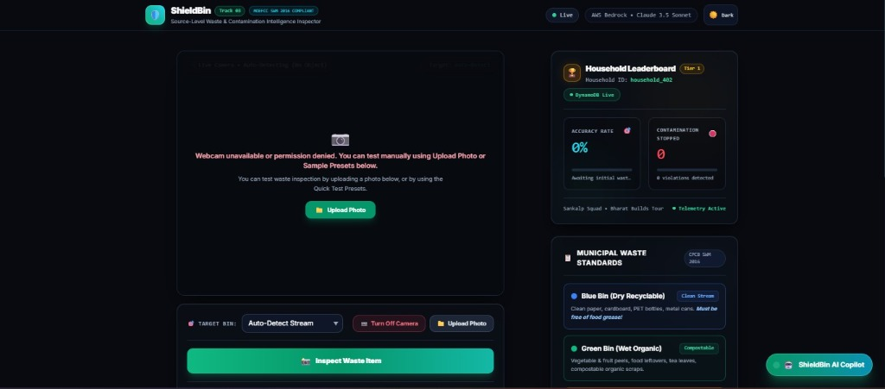
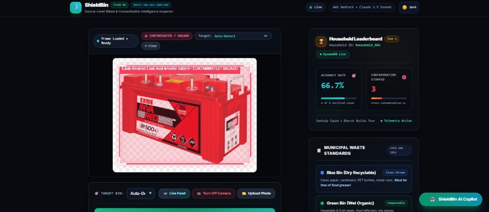
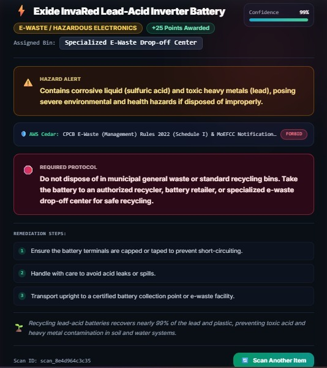
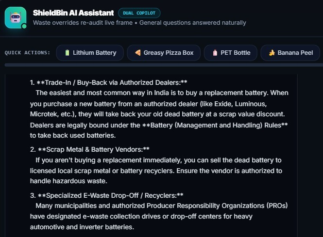

# Beyond Object Detection: Building Smarter Waste Decisions with ShieldBin ♻️

*How Team Sankalp Squad is exploring the intersection of AI, policy-as-code, and environmental technology.*

**Team Sankalp Squad | Bharat Builds Tour — Environmental Hacks, Track 03: Waste and Energy**

---

## When Recognizing Waste Isn't Enough

Can AI identify a waste item? Often, yes. But can that alone determine how it should be disposed of?

That’s the engineering challenge that makes waste management interesting. An item’s material, contamination, and applicable disposal rules can all influence the right decision. A useful solution needs to go beyond recognition and help users understand what to do next.

As part of **Team Sankalp Squad**, I’m proud to be part of the journey behind **ShieldBin**—a platform designed to bring AI-assisted waste inspection and structured disposal guidance into one experience.

---

## Connecting AI with Rules

ShieldBin explores a workflow that combines visual analysis with policy-based evaluation:

**Inspect → Analyze → Evaluate → Guide**

The platform integrates AI services, including Google Gemini and Amazon Bedrock, to support waste analysis. It also incorporates **AWS Cedar**, a policy engine that evaluates decisions against configured rules.

This separation is important: AI helps interpret the input, while the policy layer provides a structured way to evaluate the resulting information. The goal is to make disposal guidance more consistent and easier to explain—not to assume that every AI prediction is correct.

---

## More Than an Inspection Tool

Waste management also involves questions, habits, and follow-through. ShieldBin brings together an AI Copilot for conversational assistance and tracking features designed to encourage responsible segregation.

Our technology stack includes React, TypeScript, FastAPI, AWS Cedar, and Amazon DynamoDB, alongside our AI integrations and cloud deployments.

The broader idea is simple: make useful waste-disposal information easier to access at the moment a decision needs to be made.

---

## Lessons from the Build

One key takeaway is that **building a useful AI application requires more than choosing a powerful model**. The surrounding architecture, clear user experience, structured rules, and awareness of uncertainty matter just as much.

Images may not reveal hidden contamination, and disposal requirements can vary. Improving reliability and making recommendations clearer are important directions for future development.

---

## Small Decisions, Meaningful Change

ShieldBin is our attempt to explore how technology can support better everyday environmental choices. It isn't a replacement for official waste-management guidance; it is a step toward making disposal decisions more informed and accessible.

For me, the bigger idea behind the project is that innovation doesn't always need to start with complex hardware. Sometimes, it starts by helping people make better decisions with the tools they already have.

**Smarter decisions at the source can help build a cleaner future.**

---

### Explore ShieldBin

- 🌐 **Live Demo:** [https://sankalp-squad.vercel.app/](https://sankalp-squad.vercel.app/)
- ▶️ **Demo Video:** [https://youtu.be/SXVuy0h7WW0](https://youtu.be/SXVuy0h7WW0)
- 💻 **Source Code:** [https://github.com/rawatdevesh2008/Sankalp-Squad](https://github.com/rawatdevesh2008/Sankalp-Squad)

---

**Blog written by - Devesh Singh Rawat**

### Team Sankalp Squad

Garv Ghildiyal · Abhinav Singh · Devesh Singh Rawat · Abhinav Chauhan

*Built for the Bharat Builds Tour — Environmental Hacks, Track 03: Waste and Energy.*
